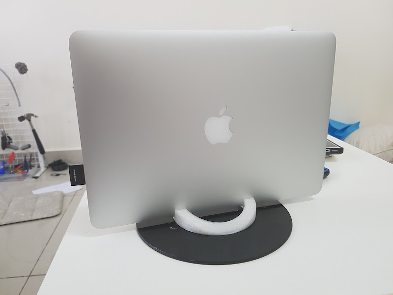
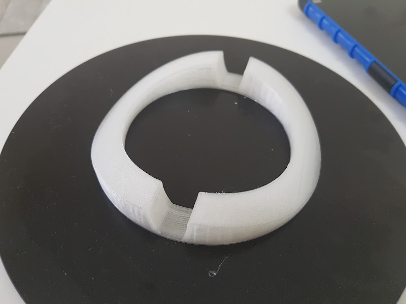
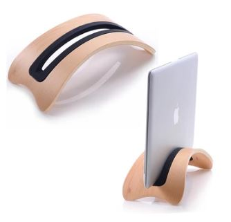
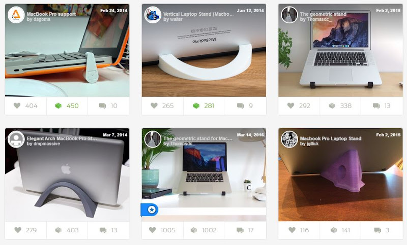

最近开坑买了一台<a href="http://ho.lazada.com.my/SHHMM0?url=http%3A%2F%2Fwww.lazada.com.my%2Fapple-macbook-pro-mf839zpa-notebook-with-retina-display-133-i527ghz-128gb-8gb-1553712.html%2F%3Foffer_id%3D%7Boffer_id%7D%26affiliate_id%3D%7Baffiliate_id%7D%26offer_name%3D%7Boffer_name%7D%26affiliate_name%3D%7Baffiliate_name%7D%26transaction_id%3D%7Btransaction_id%7D" target="_blank">macbook pro retina 13'</a>...&nbsp;

 

在家里已经有&nbsp;<a href="http://ho.lazada.com.my/SHHMM0?url=http%3A%2F%2Fwww.lazada.com.my%2Frefurbished-dell-22-inches-lcd-monitor-11118441.html%2F%3Foffer_id%3D%7Boffer_id%7D%26affiliate_id%3D%7Baffiliate_id%7D%26offer_name%3D%7Boffer_name%7D%26affiliate_name%3D%7Baffiliate_name%7D%26transaction_id%3D%7Btransaction_id%7D" target="_blank">22寸的monitor</a>了(才RM 260)&nbsp;

极简主义的我觉得桌面太满了，就忽然想起 &nbsp;<a href="http://ho.lazada.com.my/SHHMM0?url=http%3A%2F%2Fwww.lazada.com.my%2Fcatalog%2F%3Fdir%3Ddesc%26q%3Dvertical-stand-macbook-pro%26sort%3Dpricedesc%2F%3Foffer_id%3D%7Boffer_id%7D%26affiliate_id%3D%7Baffiliate_id%7D%26offer_name%3D%7Boffer_name%7D%26affiliate_name%3D%7Baffiliate_name%7D%26transaction_id%3D%7Btransaction_id%7D" target="_blank">vertical stand</a> ， 
然后就跑去thingiverse 寻宝（thingiverse&nbsp;是下载3D模型的网页） 

结果还真有，真心觉得有<a href="http://www.1m3dp.com/3dp2016guide.html" target="_blank">3D打印机</a>真方便 呵呵呵

 

<b>想要打印的朋友可以在本文下面找到免费下载链接</b>。

 

 
 
 
 

 

看起来确实不错。不过好像有点小

不过有了它就可以把它当做CPU 外接荧幕键盘滑鼠&nbsp;

非常节省空间啊~~

 
当然还有各种在网上售卖的直立stand 质量开起来不错 
当然价格也比较高咯。。。 
下图取自<a href="http://ho.lazada.com.my/SHHMM0?url=http%3A%2F%2Fwww.lazada.com.my%2Fvertical-stand-laptop-wood-stand-for-macbook-brown-10681006.html%2F%3Foffer_id%3D%7Boffer_id%7D%26affiliate_id%3D%7Baffiliate_id%7D%26offer_name%3D%7Boffer_name%7D%26affiliate_name%3D%7Baffiliate_name%7D%26transaction_id%3D%7Btransaction_id%7D" target="_blank">LAzada</a> 有兴趣可以点图去购买 

 

如果你有打印机的 可以连接这里去免费下载哦~

<b><a href="http://www.thingiverse.com/search?q=macbook+pro&amp;sa=">http://www.thingiverse.com/search?q=macbook+pro&amp;sa=</a></b> 

<b> </b>

