本blog 单纯我个人感想。想看专业的 还是看重播吧。 

<a href="/assets/img/blog/572615e7d787.png" imageanchor="1" style="margin-left: 1em; margin-right: 1em;">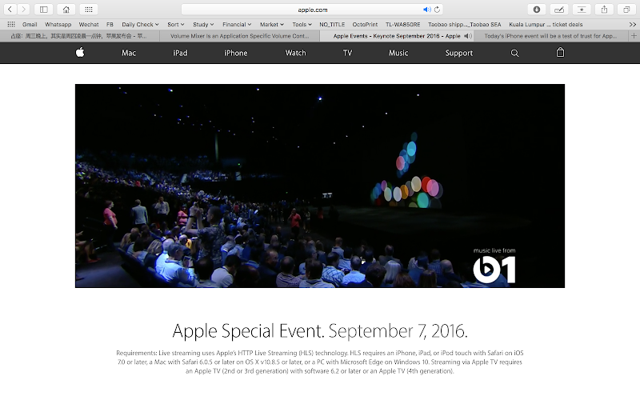</a>

 

 
1:00 am 发布会开始了~ 
这次 苹果CEO Tim Cook 
特地做了一个进场视频。 
还大唱特唱 
 
 
 
当然 这个进场是为了带出新的 车里kalaok的开发。 
 
  
然后把Mario 之父给请出来了。 
SuperMario Iphone 版本coming soon ~ 

<a href="/assets/img/blog/0156ada84bd4.png" imageanchor="1" style="margin-left: 1em; margin-right: 1em;">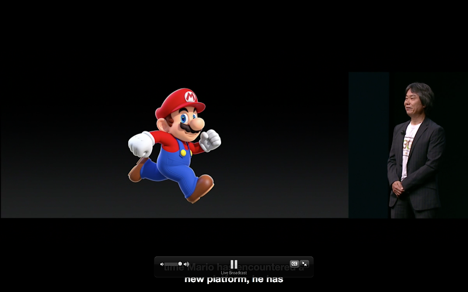</a>

 
... 咦 ？ 这个不是酷跑吗... 
 
再来更新swift 在教学界的出众, 
 
iWork 加了实时合作模式。 我个人没用所以... 跳过不说 
 
1:24 am 开始讲 apple watch! 
apple watch 在今年在“手表排行榜”成为排行第二，第一名是Rolex 
watch os3 
苹果手表 中文输入挺拽的 
手表游戏更新，pokemon go apple watch 版本@@ 

<a href="/assets/img/blog/93a2ca01dd59.png" imageanchor="1" style="margin-left: 1em; margin-right: 1em;">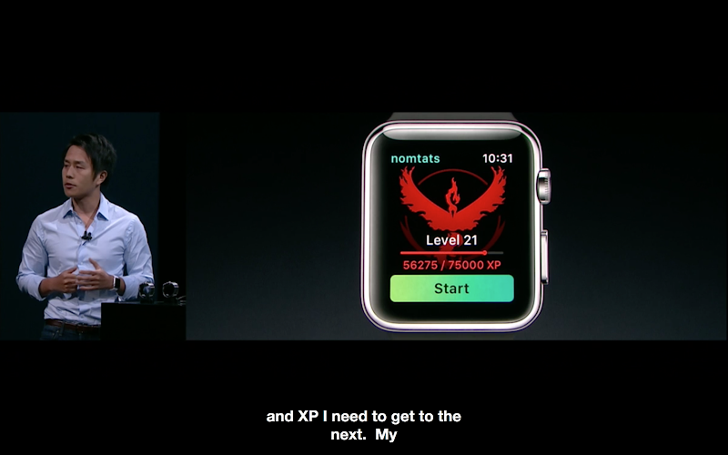</a>

可以透过手表 孵蛋 开启pokestop 查看附件 pokemon + 状态物品 。。。

 

1:36 am Apple Watch Series 2&nbsp;

50米防水 终于可以带去防水了。

<a href="/assets/img/blog/05033522f18d.png" imageanchor="1" style="margin-left: 1em; margin-right: 1em;">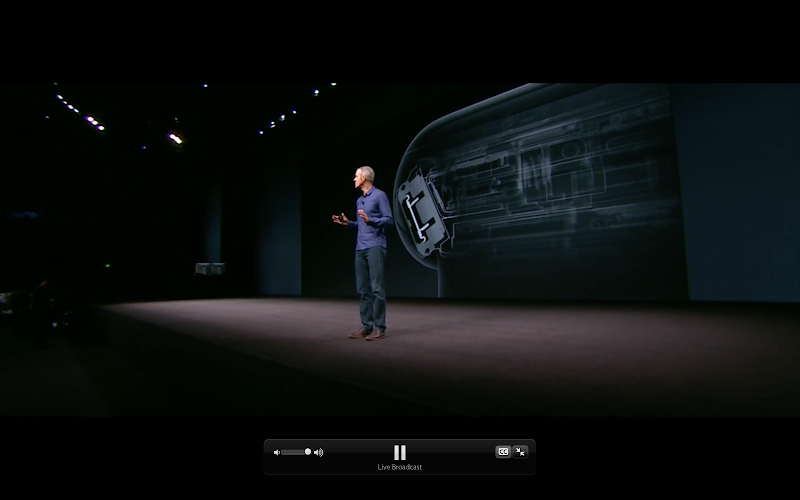</a>

喇叭孔是怎么防水？用喇叭把水打出去... &nbsp;真牛！

连游泳也可以记录多远多块之类了。

 

硬件更新:

双倍处理器,双倍graphic,高亮太阳底下查看没问题,

内建GPS爬山也能记录了。

新材料，纯白apple watch&nbsp;

 

新添加 Apple Watch Nike+ 版本

 

<a href="/assets/img/blog/d13793a02654.png" imageanchor="1" style="margin-left: 1em; margin-right: 1em;">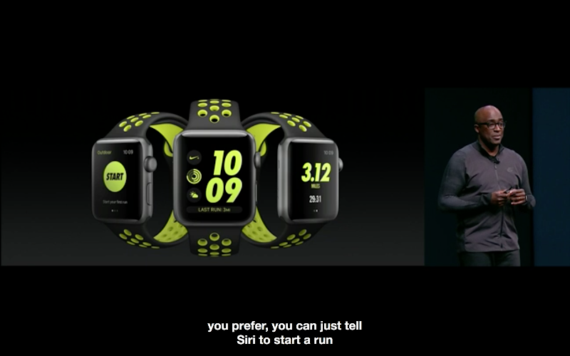</a>

 

1:54 am 来了! iPhone&nbsp;

整座山一般的镜头是怎么回事...

双镜头没有出现在iphone 7

<a href="/assets/img/blog/adf3dde233fe.png" imageanchor="1" style="margin-left: 1em; margin-right: 1em;">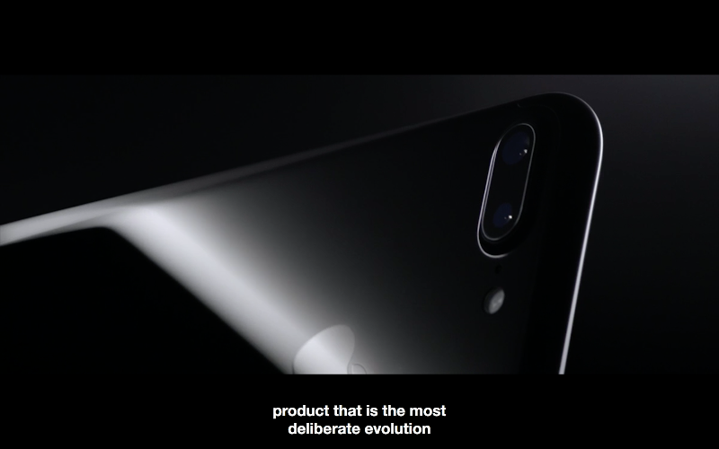</a>

 

home键更新。

IP 67 防水了

不是双镜头

<a href="/assets/img/blog/8f3ea78107e4.png" imageanchor="1" style="margin-left: 1em; margin-right: 1em;">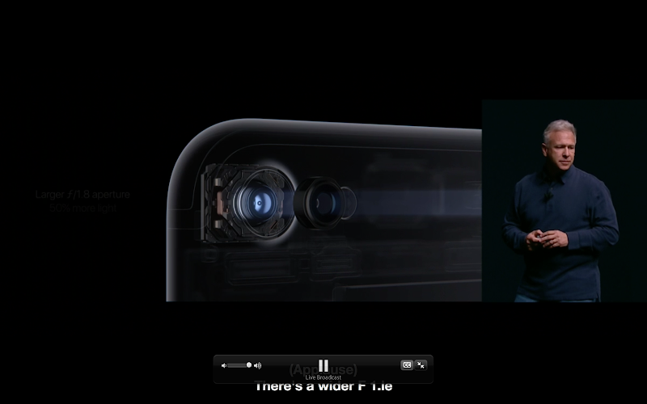</a>

 

可以拍摄Raw格式照片

前置镜头更新 7megapixel&nbsp;

 

iPhone 7 plus&nbsp;

双镜头 ...我❎忍不住要吐槽了。。。

双镜头是拿来zoom 的 ... 景深效果无敌加强

双喇叭

3.5mm 确实没有了 耳机更新 用lighning&nbsp;

如果你还是要3.5mm 没问题。原装包了这个转换器。

<a href="/assets/img/blog/104aef5fd12c.png" imageanchor="1" style="margin-left: 1em; margin-right: 1em;">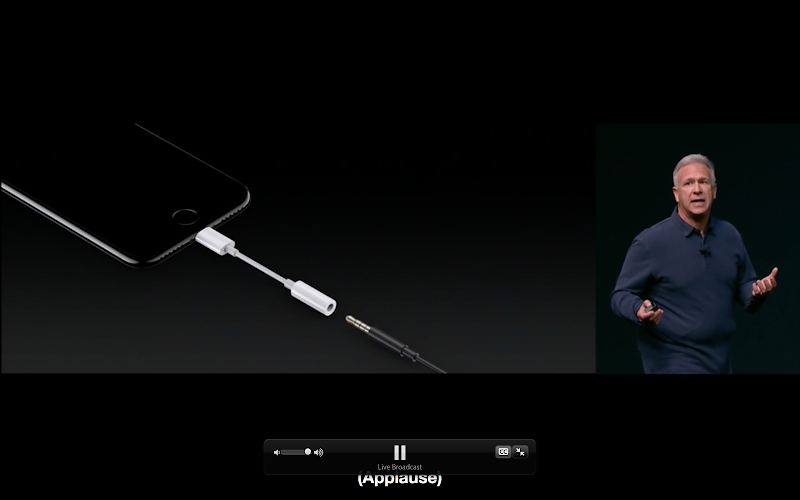</a>

新产品 无线耳机Airpods 内置很多高科技

<a href="/assets/img/blog/64d35805ee8b.png" imageanchor="1" style="margin-left: 1em; margin-right: 1em;">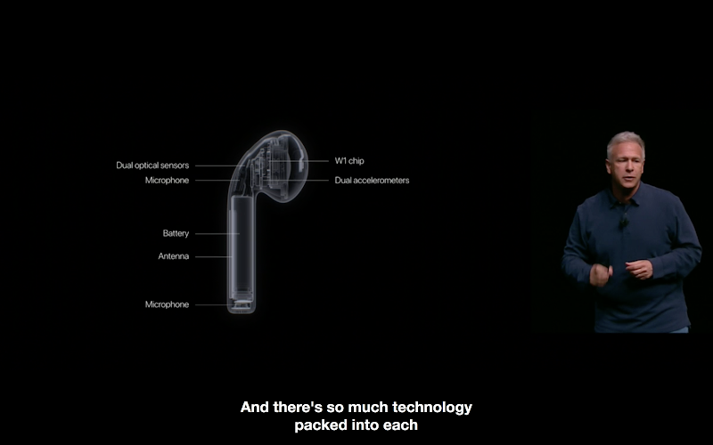</a>

<a href="/assets/img/blog/0cfc9521f44e.jpg" imageanchor="1" style="margin-left: 1em; margin-right: 1em;">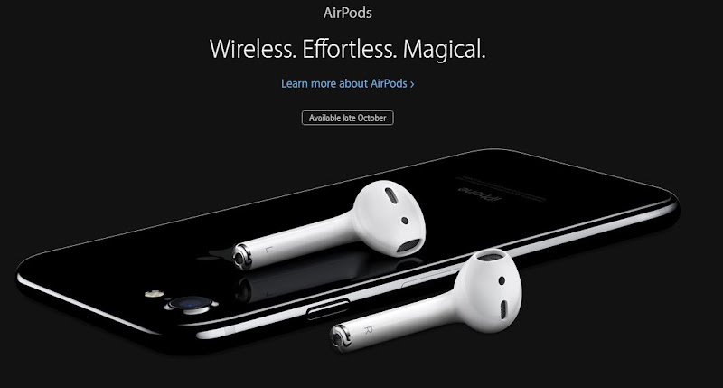</a>

 

新的处理器 A10 4core 更强更快更。。。

 

电池续航比iPhone 6s 多一小时

来总结

<a href="/assets/img/blog/8d447f60dbe2.png" imageanchor="1" style="margin-left: 1em; margin-right: 1em;">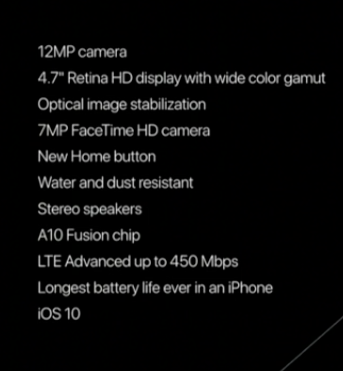</a>

 

价格:649 美金 iPhone7 iPhone 7plus 听不急

无线耳机 169 美金...

 

接下去 反正马来西亚都不在首发国家。就只好看别人youtube Review 了

 

晚安。

