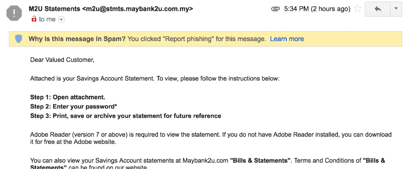

今天 我收到一封这样的邮件，这样的邮件 一年到头如果我不把信息拉到spam 的话可以收到好几百封。 
 
 
 
  
这是欺诈邮件。 
既然收到了 就在这里写个博客告诫一下各位吧。 
 
现在网络过账买东西非常方便， 
相对的骗子也找到很多入手的地方 努力骗你辛苦的血汗钱。 
伪装银行的邮件是期中一种常见的手法， 
 
伪装银行欺诈邮件辨别方法1 
我使用的是maybank， 
在上面截图中，你会看到Maybank2u.com.my 的域名电邮 
Maybank 电子邮件发件人地址是这个 ： 
m2u@maybank.com.my 
 
而这封邮件发信人是 
m2u@stmts.maybank2u.com.my 
 
看出来分别吗？如果没有 注意高亮的部分 &gt;&gt;&nbsp;m2u@<b>stmts.</b>maybank2u.com.my 
不用半秒 你就能看出来这邮件是假的。 
 伪装银行欺诈邮件辨别方法2 
如果你不确认那个邮件是否真实银行发来的呢？ 那可以透过邮件内容判断。  银行是<b>不会</b>发邮件叫你在银行以外的网站登入你的账户密码。 
你可以清楚从上面截图看到 邮件内容让我下载附件 和<b>输入密码。 </b> 
即使银行打电话来让你验证身份 也<b>不会</b>和你要以下2个信息。 》银行登入密码 
》手机收到的sms tag number 
绝对不能透露给任何人 电话甚至银行职员。 
注意这两点 保护好你的银行户口吧~ 
 
很多年前我第一次收到这类邮件的时候， 
我产生这样的疑问， 
这样的邮件真的有人上当吗？ 然而在几年前我一个同事上当了，银行户口储蓄被掏空。 
虽然还是有办法追回。但那也是几个月后的事情了。 
骗子发几千几万封邮件出去 只要有1%的人上当 他们就赚了。 
 
分享这个信息给你的朋友吧。 
尤其自己身边的人 别让自己辛辛苦苦的血汗钱被骗子掏去哦~ 
 