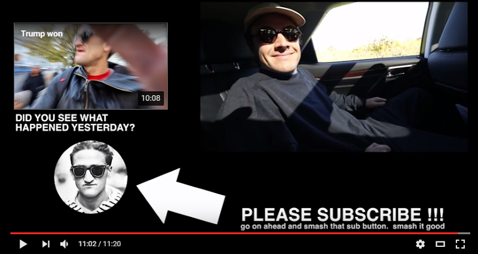
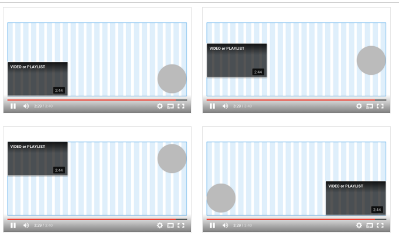
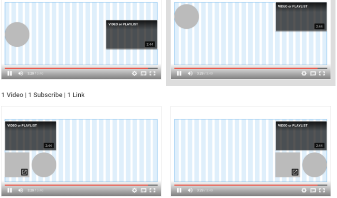
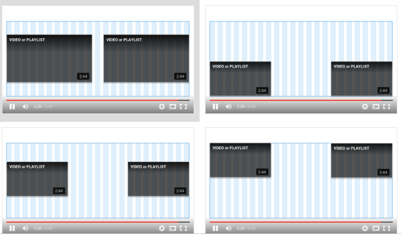
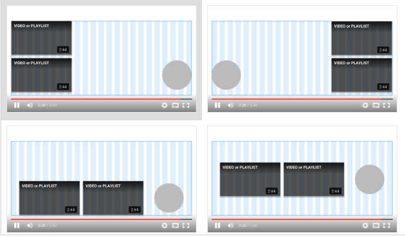
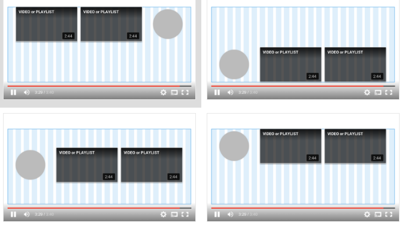
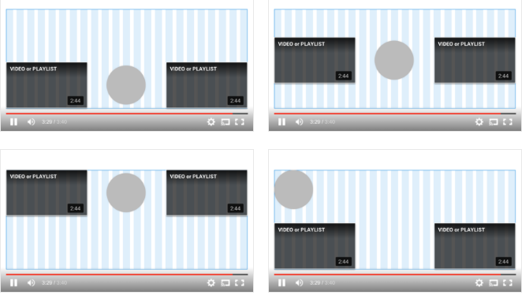
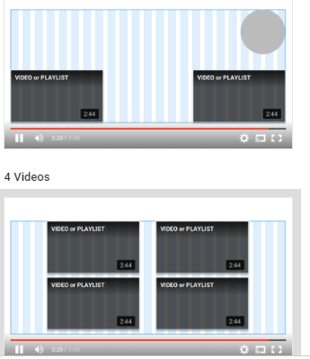

End screen是一个可以在影片中添加影片鏈接 
以便建議觀眾观看你其他video 的功能。

 
**以前是人工在原影片上edit想要轉的video 
然後上傳后再用annonation鏈接 打框框鏈接。（很麻煩！而且手機觀看用戶點不了） 
更新后的end screen 可以在手機上用了。 
 

如下图所示 这个是sample （取自知名<a href="https://www.youtube.com/user/caseyneistat" target="_blank">Youtuber Casey Neistat</a>）

 

圓形頭像 和上面四方框 並非存在影片中。

圓形頭像是訂閱按鈕

上面的四方框是一個可以隨時更換建議的視頻鏈接。 

 

只需要留空給這些元素就可以了。

 
要注意的是

此功能只适用于要是在影片<b>开始后20秒</b> 或者结束后<b>保留5秒 設計</b>

少于20秒的影片用不了. 
 
你可以运用下面的排版 或者 自己设计喜欢的排版。 
 
(有元素的部分留空 没有的可以加文字如 点这里订阅 点这里更多视频之类&nbsp;)

 

 

 

 

 

 

 

 

 

 
 

