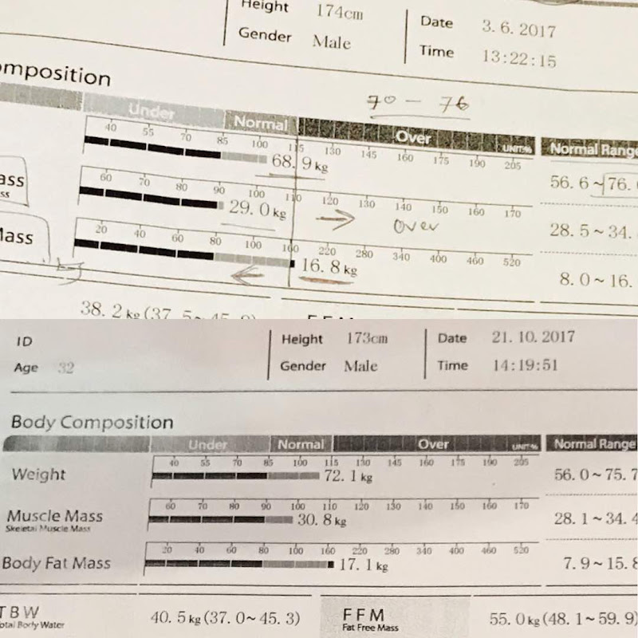
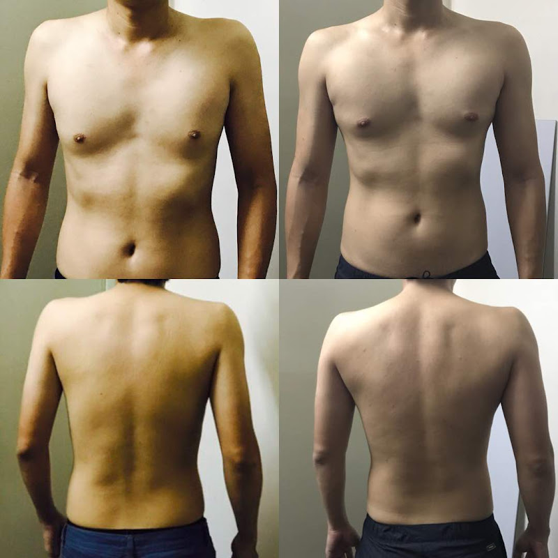
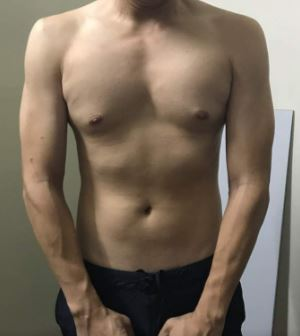

今年的6月份某一天 
我在埋头思考是否辞职转而将副业发展起来。 
在发展这个副业上我应该是什么样的一个角色解决什么样的问题。 
 
在这个思绪上卡了许久，然而在这种脑顿的状态突发奇想。 
“如果连自己都改变不了 还能改变什么” 
而我最需要改变的 是生活习惯， 健康状态。 
 
最显而易见的就是从身形开始。 
健身是最显而易见的。 
就这样 我挖了健身房这个坑。 
 
当天我就踏入健身房加入了会员 找了个一对一教练 
是的那个费用让人心疼。可是花钱购买别人的经验 我觉得是省时间最快的方式。 
 “时间什么时候没有比钱贵？有的 就在你上班的时候” 
没什么借口 我就那么开始了。 
 
  
不知不觉今天 已经是第四个月了。 每星期两次 没有间断。 
每天努力往嘴里塞食物， 从不吃也不太知道什么叫做肚子饿，到4小时不吃会饿到情绪暴躁...  
然而4个月过去了并没有很激励的成果。 
我小看了健身的难度。这东西比想象需要学的更多 
没错只是身体上肌肉组织的分类数量就超过了一台最复杂的3D打印机的零件数量。 （我的副业是这个 也就只能拿这个来比喻了） 
 扯远了... 实际上进度呢？涨了1.8公斤肌肉 300克的fat 
 
 

左17年6月 右17年10月

post 版 17年10月

 
 
我的目标是增加5公斤肌肉 然后降低2公斤 Fat 那怎么办，我每天吃的应该够了 可是已经无法再增加吃次数和数量 因为工作关系 抽时间出来吃 Pre lunch 和 tea time 并不一定能办到  经过各种了解和与教练的沟通 
购买了 Mass Gainer 主要的用途是来补我靠食物吸取不够的卡路里蛋白之类  今天是第一天开始喝。。。甜得舌头觉得好瑟 
不过总比吃更多硬食来的简单。 
 
记录到这里。一个月后再记录成果。 